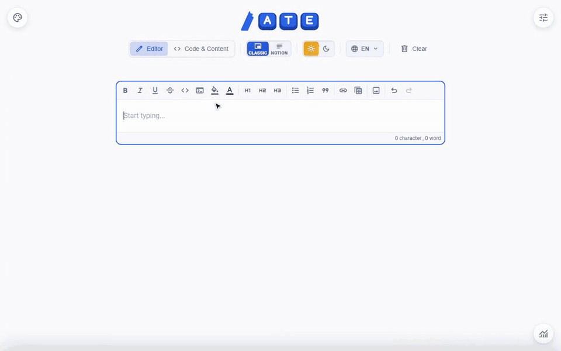

<p align="center">
  <picture>
    <source media="(prefers-color-scheme: dark)" srcset="assets/logo/svg/logo-keys-dark.svg">
    
  </picture>
</p>

# Angular Tiptap Editor

> [!IMPORTANT]
> **^v3.0.0 uses Tiptap v3**. If you need to stay on Tiptap v2, please use version `^2.4.1`.

A modern, customizable Angular rich-text editor, built with **Tiptap**.

[](https://www.npmjs.com/package/@flogeez/angular-tiptap-editor) [](https://flogeez.github.io/angular-tiptap-editor/) [](https://stackblitz.com/edit/angular-tiptap-editor)

High-performance Angular WYSIWYG editor. Built on top of **Tiptap** and powered by a native **Signals** architecture, it features a polished, professional design that feels, I think, clean and modern out of the box.
Yet, I've worked to keep it fully customizable: you can easily configure the editor, tweak the UI, or even embed your own Angular components as interactive nodes.

<p align="center">
  
</p>

---

## ✨ Features

- ⚡ **Signal-Based**: Native performance with `ChangeDetectionStrategy.OnPush`.
- 📋 **Table of Contents**: Notion-style floating or inline TOC component with level-adapted dash collapse.
- 🗂️ **Global Editor Registry**: Centralized `AteEditorRegistry` service to track, control, and switch between multi-editor instances.
- 🧩 **Angular Nodes**: Embed any Angular component as an interactive editor node.
- ⌨️ **UX First**: Slash commands (`/`) and context-aware bubble menus (Notion-like).
- 📊 **Table Power**: Advanced management with cell selection and merging.
- 🖼️ **Pro Media**: Image resizing, auto-compression, and custom uploaders.
- 🌍 **Built-in i18n**: Support for English, French, German, Brazilian Portuguese, and Spanish out of the box.
- 📎 **Office-Ready**: Clean pasting from Word and Excel, with control over what is kept from other apps (`paste`: colors, highlights, `transformHTML` hook).
- 🎨 **Highly Customizable**: Easily configure toolbars, bubble menus, and slash command items.
- 🛠️ **Extensible**: Easily add custom Tiptap extensions and reactive state calculators.
- 🧩 **Angular 18+ Support**: Uses Angular 18's signals and esbuild for optimal performance.

## 📦 Installation

```bash
npm install @flogeez/angular-tiptap-editor
```

Add the styles to your `angular.json`:

```json
{
  "styles": [
    ...
    "node_modules/@flogeez/angular-tiptap-editor/styles/index.css",
    ...
  ]
}
```

### Icons

The library ships every icon it uses as inline SVG ([Material Symbols](https://fonts.google.com/icons), Apache 2.0): no icon font is required.

To use **any** Material Symbols name in your own toolbar items, bubble menus or slash commands, also load the font. Unregistered names fall back to it:

```json
"node_modules/@fontsource/material-symbols-outlined/index.css",
```

Library icons are keyed by what they do, not by what they draw: `bold`, `heading1`, `bulletList`, `link`, `unsetLink`, `addRowBefore`, `mergeCells`, `deleteTable`, `undo`… (see the `AteIconName` type for the full list). Override any of them, use the built-in `/ATE` stroke set (`ATE_STROKE_ICONS`), or register your own icons with `provideAteIcons` at application bootstrap (`app.config.ts` / `main.ts`), or at runtime with `inject(AteIconRegistry).register(...)`:

```typescript
providers: [
  provideAteEditor(),
  provideAteIcons(ATE_STROKE_ICONS), // or pass a custom AteIcons map:
  provideAteIcons({
    bold: '<svg viewBox="0 0 24 24" fill="none" stroke="currentColor" stroke-width="2"><path d="…"/></svg>', // full <svg>: any viewBox, keeps its own fill/stroke
    rocket: '<path d="…"/>', // or inner markup: Material Symbols viewBox (0 -960 960 960), filled with currentColor
  }),
];
```

Custom toolbar items, bubble menu items and slash commands can then use `icon: "rocket"`. Icons are sized with `1em`. Use `currentColor` in a full `<svg>` (`fill` or `stroke`) so it follows the text color, like the library icons do. Use `<ate-icon name="…" />` to render them in your own components.

## 🚀 Quick Start

### 1. Global Setup

Initialize the library in `app.config.ts`:

```typescript
export const appConfig: ApplicationConfig = {
  providers: [provideAteEditor()],
};
```

### 2. Basic Usage

```typescript
import { AngularTiptapEditorComponent } from "@flogeez/angular-tiptap-editor";

@Component({
  selector: "app-example",
  standalone: true,
  imports: [AngularTiptapEditorComponent],
  template: `<angular-tiptap-editor
    [content]="content"
    (contentChange)="onContentChange($event)" />`,
})
export class ExampleComponent {
  content = "<p>Hello World!</p>";
  onContentChange(html: string) {
    console.log(html);
  }
}
```

### 3. Reactive Forms Integration

```typescript
import { FormControl, ReactiveFormsModule } from "@angular/forms";

@Component({
  standalone: true,
  imports: [AngularTiptapEditorComponent, ReactiveFormsModule],
  template: ` <angular-tiptap-editor [formControl]="contentControl" /> `,
})
export class FormComponent {
  contentControl = new FormControl("<p>Initial content</p>");
}
```

## ⚙️ Configuration

The editor is fully configurable via the `[config]` input:

```typescript
editorConfig: AteEditorConfig = {
  locale: "fr",
  placeholder: "Commencez à rédiger...",
  toolbar: { ...ATE_DEFAULT_TOOLBAR_CONFIG, highlight: true },
  slashCommands: { heading1: true, table: true },
};
```

| Input        | Type              | Description                        |
| ------------ | ----------------- | ---------------------------------- |
| `[config]`   | `AteEditorConfig` | Global config object (recommended) |
| `[content]`  | `string`          | Initial HTML content               |
| `[editable]` | `boolean`         | Read-only toggle                   |
| `[disabled]` | `boolean`         | Disabled toggle                    |

_See the [API reference](./API.md) for the full list of inputs and configuration options._

## 🧩 Advanced Features

### Image Upload Handler

Avoid base64 by providing a custom uploader (S3, Cloudinary, etc.):

The same handler is used for all file-based image insertions: toolbar picker, drag-and-drop, and clipboard paste.

```typescript
uploadHandler: AteImageUploadHandler = ctx => {
  return this.http.post<any>("/api/upload", ctx.file).pipe(map(res => ({ src: res.url })));
};
```

### Image URL Resolver

Images behind authentication? Use `[imageSrcResolver]` (or `imageSrcResolver` in `[config]`) to show a different URL (e.g. a `blob:` fetched with a token) while the document keeps the original `src`. See [Images Behind Authentication](./ADVANCED.md#images-behind-authentication-imagesrcresolver).

---

### 🚀 More Advanced Capabilities

Looking for deeper integration patterns? Explore our **[Advanced Usage Guide](./ADVANCED.md)**:

- 🧩 **[Custom Angular Nodes](./ADVANCED.md#-embedding-angular-components-angular-nodes)**: Embed any Angular component as interactive editor nodes.
- 📋 **[Table of Contents](./ADVANCED.md#-table-of-contents-component-atetableofcontentscomponent)**: Responsive, Notion-style floating or inline TOC.
- 🗂️ **[Global Editor Registry](./ADVANCED.md#-global-editor-registry-ateeditorregistry)**: Track and control multi-editor instances via DI.
- ⚡ **[Programmatic Control](./ADVANCED.md#-programmatic-control-with-ateeditorcommandsservice)**: Execute commands remotely via `AteEditorCommandsService`.
- ⌨️ **[Custom Slash Commands](./ADVANCED.md#️-custom-slash-commands)**: Add custom actions and templates to the `/` menu.
- 🛠️ **[Tiptap Extensions & State Calculators](./ADVANCED.md#️-custom-tiptap-extensions)**: Extend schema and custom reactive state.

## 🌍 i18n & 🎨 Styling

- **Languages**: English (`en`), French (`fr`), German (`de`), Portuguese (`pt`, Brazilian wording) and Spanish (`es`) built-in. Detects browser language automatically (regional tags like `pt-BR` or `es-MX` resolve to their language). Set `locale` on one editor (input or config) to translate that instance only, with no effect on other editors or the global locale. Extend with `AteI18nService.addTranslations()`.
- **Styling**: Customize via CSS variables (e.g., `--ate-primary`, `--ate-border-radius`, and much more).
- **Dark Mode**: Works natively by adding `.dark` or `[data-theme="dark"]`.

## 🔧 Development

```bash
npm install
npm run build:lib  # Build library
npm start          # Run demo
```

## 📝 License

MIT License - see [LICENSE](LICENSE) file for details.

## 🤝 Contributing

Contributions are welcome! See [CONTRIBUTING.md](./CONTRIBUTING.md) for the setup, checks and conventions.

## 🔗 Links

- 📖 [Tiptap Documentation](https://tiptap.dev/)
- 📦 [NPM Package](https://www.npmjs.com/package/@flogeez/angular-tiptap-editor)
- 📖 [Live Demo](https://flogeez.github.io/angular-tiptap-editor/)
- 🐛 [Report Issues / Feature Requests](https://github.com/FloGeez/angular-tiptap-editor/issues)

Made with ❤️ by [FloGeez](https://github.com/FloGeez)
